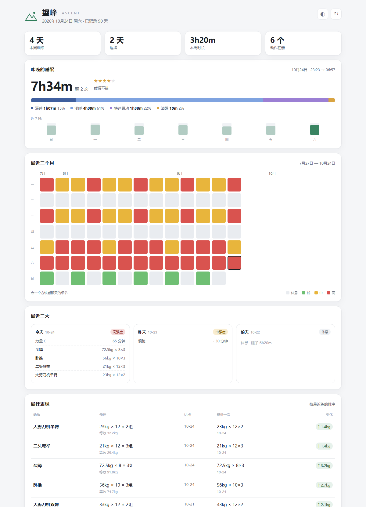

# 望峰 · Ascent

> 睡眠、训练强度、动作组数与个人最佳——说一声就记下，打开网页就能看见。
> 数据全在 `~/.dsh/wangfeng/`，纯本地，不联网。

[](https://github.com/Li-yuan-0910/dsh-wangfeng/actions/workflows/test.yml)
[](LICENSE)



<p align="center"><sub>截图使用示例数据，不是真实记录。</sub></p>

---

## 它是什么

一个只负责**记录和展示**的训练本，挂在 [DeepSeek Harness](https://github.com/deepseek-ai/deepseek-harness) 上：

- 你在对话里说「昨晚睡了多久、今天练了什么」，它拆成结构化的数字记下来；
- 网页只读，把**睡眠 / 最近三个月热力图 / 最近三天 / 最佳表现**画在一页里；
- 不填表、不联网、不同步手环、不做社交。

名字里的「望峰」，英文取 **Ascent**——往峰顶去的那一段路，也暗合「一次比一次高」。

---

## 页面里有什么

| 区块 | 内容 |
|---|---|
| **昨晚的睡眠** | 总时长、1–5 星质量、清醒次数、深睡 / 浅睡 / REM / 清醒的堆叠条、近 7 晚趋势 |
| **最近三个月** | 13 周 × 7 天的热力图，四档颜色（休息 / 低 / 中 / 高）；点方块看当天睡眠与动作 |
| **最近三天** | 今天、昨天、前天练了什么，组数、次数、重量 |
| **最佳表现** | 每个动作的最佳一组、达成日、最近一次、涨跌 |

- 深浅色跟随系统，右上角也能手动切换；
- 手机窄屏自动单列，热力图会缩放适配；
- 60 秒自动刷新，右上角可手动刷新；
- 「导出」把全部数据打成一个 JSON。

### 三个入口

1. **设置 → 望峰**（设置导航里的独立一项）
2. **设置 → 插件 → 望峰**（插件分区里的标签页）
3. **插件（侧栏）→ 已安装 → `dsh-wangfeng` → 打开望峰**

也可以直接开 `http://127.0.0.1:<当前端口>/dsh-wangfeng/`。端口每次启动 DSH 会变，所以平时用上面三个入口最稳。

---

## 怎么用

不需要口令，正常说就行：

```text
昨晚睡了 7 小时 12 分，快速眼动 22%，浅睡 58%，深睡 15%，醒了 1 次，质量 4 星。
今天练了：辅助引体，辅助 40kg（自重 70），3 组 8 次；
大剪刀机单臂 15kg，2 组 12 次；大剪刀机双臂 25kg，2 组 12 次；二头弯举 25kg，3 组 12 次。
```

- 只说睡眠、只说运动都可以，分两次说也行；
- 补记：「昨天打了三个小时篮球」「补记 10 月 20 日：……」；
- 说错了：「深睡其实是 1 小时 20 分」——同一天重记，按字段覆盖；
- 没给强度时，助手会按训练量估一档，并注明「估的」；
- 不会替用户编数字：没说的字段就是空。

### 工具

| 工具 | 用途 |
|---|---|
| `wangfeng_log` | 记一天的睡眠 / 强度 / 运动 / 动作 |
| `wangfeng_status` | 查今天记了没、连续天数、最近最佳 |

---

## 最佳表现怎么算

只看力量动作，比的是**等效最大重量**：

```text
等效最大重量 = 有效重量 × (1 + 次数 ÷ 30)
有效重量 = 辅助动作取「自重 − 辅助重量」，其余就是器械 / 杠铃重量
```

举两个例子（示例数字）：

| 动作 | 这一组 | 有效重量 | 等效最大重量 |
|---|---|---|---|
| 辅助引体，辅助 40kg，自重 70kg | 8 次 | 30kg | 30 × (1 + 8/30) ≈ **38.0** |
| 大剪刀机单臂 15kg | 12 次 | 15kg | **21.0** |
| 大剪刀机单臂 10kg（上次） | 12 次 | 10kg | **14.0** |

规则：

- 多组取**最好的一组**；等效重量一样时比容量（组 × 次 × 重量）；
- 辅助动作按「自重 − 辅助」算，辅助越少越好，不会把「辅助 80kg」误判成比「辅助 60kg」更重；
- 没超过最佳不替换，页面标 `↓`，但记录照留；
- 有氧（篮球、跑步）不进最佳榜，只出现在热力图和三天记录里；
- 动作名以 `movements.json` 为准，同义写法会自动归并；归错了改字典，历史跟着正。

---

## 安装

### 从 GitHub 安装（推荐）

1. DSH 侧栏打开 **插件** → **添加插件** → **安装第三方插件**；
2. 填仓库地址：

   ```text
   https://github.com/Li-yuan-0910/dsh-wangfeng
   ```

3. 安装完成后启用 `dsh-wangfeng`，按提示重启 DSH；
4. 重启后从 **设置 → 望峰** 打开。

命令行安装（如果你的 DSH 版本支持）：

```bash
dsh plugin --profile desktop add github:Li-yuan-0910/dsh-wangfeng
```

### 本地开发安装

```bash
git clone https://github.com/Li-yuan-0910/dsh-wangfeng.git
cd dsh-wangfeng
npm test
npm run demo   # 打开 http://127.0.0.1:5098 ，用示例数据预览
```

<details>
<summary>把本地目录挂进 DSH（开发用）</summary>

1. 在 profile 的 `package.json` 里加依赖：

   ```json
   "dsh-wangfeng": "link:C:/path/to/dsh-wangfeng"
   ```

2. `dsh.profile.bundles` 末尾加 `"dsh-wangfeng"`；
3. 在 `~/.dsh/profiles/desktop/node_modules/` 建 junction（Windows）：

   ```powershell
   New-Item -ItemType Junction `
     -Path "$env:USERPROFILE\.dsh\profiles\desktop\node_modules\dsh-wangfeng" `
     -Target "C:\path\to\dsh-wangfeng"
   ```

4. 重启 DSH。

</details>

---

## 数据与隐私

```text
~/.dsh/wangfeng/
├── days/
│   └── 2026-10-24.json      # 一天一个文件，记事本能打开
└── movements.json           # 动作字典（正式名 + 别名）
```

- 数据**不在插件目录**里：插件删掉、换掉，记录都还在；
- 凌晨 4 点前算前一天，半夜记不会记岔日；
- 写文件用「临时文件 + 改名」，断电不会写坏；
- 不联网、不上传、没有遥测；网页只监听本机回环地址；
- 页面右上角「导出」可以打包备份全部数据。

---

## 开发

没有运行时依赖，Node.js ≥ 20。

```bash
npm test        # 最佳表现 / 数据层 / 宿主半边，共 3 组测试
npm run seed:demo   # 生成示例数据到 .demo-data/（已 gitignore）
npm run demo        # 示例数据 + 本地预览 http://127.0.0.1:5098
npm run dev         # 真实数据（~/.dsh/wangfeng）预览
```

### 目录

```text
dsh-wangfeng/
├── index.js              # 宿主：工具、路由、每轮上下文
├── lib/
│   ├── store.js          # 日文件、动作字典、合并、原子写
│   ├── pr.js             # 等效重量、最佳表现、统计
│   ├── snapshot.js       # 网页数据快照
│   └── report.js         # 记完回话 / 状态摘要
├── web/index.html        # 整个网页（内联 CSS/JS，无 CDN）
├── client.js             # 设置页入口
├── tools/                # 本地服务器、测试、示例数据
├── assets/               # 截图
├── cordis.patch.yml      # 插件挂载声明
├── icon.svg
├── DESIGN.md             # 设计稿
└── CHANGELOG.md
```

页面每次请求现读 `web/index.html`，改样式刷新即可；宿主代码改了要重启 DSH。

---

## License

[MIT](LICENSE) © 2026 Li-yuan-0910
